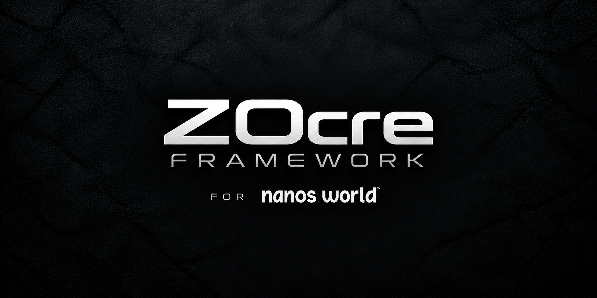

<!-- ZOCRE_LOADING_ARTWORK_START -->
<p align="center">
  <picture>
    <source media="(prefers-color-scheme: dark)" srcset="assets/branding/zocre-framework.png">
    
  </picture>
</p>
<!-- ZOCRE_LOADING_ARTWORK_END -->

<h1 align="center">ZOcre Loading Screen</h1>

<p align="center"><strong>Écran de chargement officiel ZOcre pour NANOS / nanos world.</strong></p>

<p align="center">
  
  <a href="https://discord.gg/Ey4dn4Cbqj">
    
  </a>
  <a href="https://ko-fi.com/ncoreframework">
    
  </a>
</p>

> **Version GitHub : 0.5.2 — version Vault/Store : 0.5.1.**  
> La mise à jour GitHub reprend l’identité ZOcre et son logo transparent. La version **0.5.1** déjà distribuée sur le Vault/Store NANOS reste inchangée. L’identifiant technique de package reste celui indiqué dans les instructions d’installation.

## Français

### Présentation

**ZOcre Loading Screen** est un écran de chargement NANOS autonome. Il fonctionne sans le framework principal, sans base de données et sans dépendance gameplay.

### Fonctionnalités

- progression réelle fournie par NANOS via `UpdateScreen` ;
- timeline compacte des étapes de chargement ;
- interface française et anglaise avec fallback anglais ;
- trois fonds locaux configurables en slideshow ;
- logo ZOcre Framework transparent ;
- fond vidéo WebM local optionnel ;
- audio local WebM/OGG optionnel ;
- URL audio HTTPS directe optionnelle ;
- lecture YouTube optionnelle en mode best-effort ;
- musique désactivée par défaut pour privilégier la stabilité NANOS/CEF ;
- aucun framework JavaScript lourd et aucun CDN obligatoire.

### Structure

```text
ncore-loading-screen/
├── Package.toml
├── index.html
├── Config/
│   └── config.js
├── Script/
│   ├── config-runtime.js
│   ├── app.js
│   └── style.css
├── Licenses/
│   ├── LICENSE.md
│   ├── COPYRIGHT.md
│   └── NOTICE.md
├── Languages/
│   ├── fr.js
│   └── en.js
└── assets/
```

`Package.toml` et `index.html` restent à la racine conformément au contrat NANOS du type `loading-screen`.

### Configuration

La configuration utilisateur se trouve uniquement dans `Config/config.js`. Le fichier est organisé en sections courtes et lisibles ; les réglages techniques restent internes à `Script/config-runtime.js`, qui construit et valide la configuration effective.

Le schéma de configuration courant est `schemaVersion = 1`.

Pour passer de 0.5.1 à 0.5.2, conservez une copie de votre configuration, puis reportez vos réglages dans le nouveau `Config/config.js`. Ne remplacez pas ce nouveau fichier par la copie de la version précédente : les identifiants internes de configuration ont été actualisés avec l’identité ZOcre.

Valeurs audio par défaut :

```text
music.enabled = false
music.mode    = "youtube"
music.volume  = 0.60
```

Lorsque la musique est activée, le bouton du mini-player gère pause/reprise. Les flèches haut/bas règlent le volume. Il n'existe pas de raccourci global Espace.


### Installation NANOS

Le loading screen NANOS nécessite un serveur dédié. Vérifiez que `dedicated_server = true`. **Pour les versions 0.5.1 et 0.5.2, conservez l'identifiant technique de package utilisé par NANOS**, puis configurez :

```toml
[game]
loading_screen = "ncore-loading-screen"
```

L'identifiant technique de la version 0.5.1 ne doit pas être renommé isolément : sa migration nécessite une coordination avec le Vault/Store NANOS, la configuration serveur et la version du package.

### Liens officiels

- Discord officiel : https://discord.gg/Ey4dn4Cbqj
- GitHub officiel : https://github.com/zocre-framework-official/zocre-loading-screen
- Vault / Store NANOS : https://nanos-world.com/store/packages/ncore-loading-screen
- Soutenir ZOcre / Ko-fi : https://ko-fi.com/ncoreframework

Dans le loading screen, cliquer sur ces entrées copie l'URL dans le presse-papiers au lieu de naviguer dans le WebUI CEF.

### Licence

Voir `Licenses/LICENSE.md`, `Licenses/AI-POLICY.md`, `Licenses/COPYRIGHT.md` et `Licenses/NOTICE.md`.

ZOcre Loading Screen est un logiciel propriétaire ZOcre. Les droits d'utilisation d'une copie officielle sont définis par la licence incluse dans le package.

---

## English

### Overview

**ZOcre Loading Screen** is a standalone NANOS loading screen. It works independently of the main framework, without a database, and without gameplay dependencies.

### Features

- real loading progress provided by NANOS through `UpdateScreen`;
- compact loading-stage timeline;
- French and English UI with English fallback;
- three configurable local slideshow backgrounds;
- transparent ZOcre Framework logo;
- optional local WebM video background;
- optional local WebM/OGG audio;
- optional direct HTTPS audio URL;
- optional best-effort YouTube playback;
- music disabled by default for NANOS/CEF stability;
- no heavy JavaScript framework and no mandatory CDN.

### Layout

```text
ncore-loading-screen/
├── Package.toml
├── index.html
├── Config/
│   └── config.js
├── Script/
│   ├── config-runtime.js
│   ├── app.js
│   └── style.css
├── Licenses/
│   ├── LICENSE.md
│   ├── COPYRIGHT.md
│   └── NOTICE.md
├── Languages/
│   ├── fr.js
│   └── en.js
└── assets/
```

`Package.toml` and `index.html` stay at package root as required by the NANOS `loading-screen` contract.

### Configuration

User configuration is located only at `Config/config.js`. The file is organized into short, readable sections; technical settings remain internal to `Script/config-runtime.js`, which builds and validates the effective configuration.

The current configuration schema is `schemaVersion = 1`.

When moving from 0.5.1 to 0.5.2, back up your configuration, then carry your settings into the new `Config/config.js`. Do not overwrite the new file with the previous version: internal configuration identifiers have been updated for the ZOcre identity.

Default audio policy:

```text
music.enabled = false
music.mode    = "youtube"
music.volume  = 0.60
```

When music is enabled, the mini-player button controls pause/resume. Arrow Up/Down controls volume. There is no global Space shortcut.


### NANOS installation

NANOS loading screens require a dedicated server. Set `dedicated_server = true`. **For versions 0.5.1 and 0.5.2, preserve the current technical package identifier for NANOS compatibility**, then configure:

```toml
[game]
loading_screen = "ncore-loading-screen"
```

The technical package identifier of version 0.5.1 must not be renamed in isolation. Any migration requires coordinated changes to the NANOS Vault/Store, server configuration and released package.

### Official links

- Official Discord: https://discord.gg/Ey4dn4Cbqj
- Official GitHub: https://github.com/zocre-framework-official/zocre-loading-screen
- NANOS Vault / Store: https://nanos-world.com/store/packages/ncore-loading-screen
- Support ZOcre / Ko-fi: https://ko-fi.com/ncoreframework

Inside the loading screen, clicking these entries copies the URL to the clipboard instead of navigating the CEF WebUI.

### License

See `Licenses/LICENSE.md`, `Licenses/AI-POLICY.md`, `Licenses/COPYRIGHT.md`, and `Licenses/NOTICE.md`.

ZOcre Loading Screen is proprietary ZOcre software. Rights for an official copy are defined by the license included with the package.


---

## Support public

- Discord officiel : https://discord.gg/Ey4dn4Cbqj
- Organisation ZOcre Framework : https://github.com/zocre-framework-official
- Soutenir ZOcre / Ko-fi : https://ko-fi.com/ncoreframework
- Support : [SUPPORT.md](SUPPORT.md)
